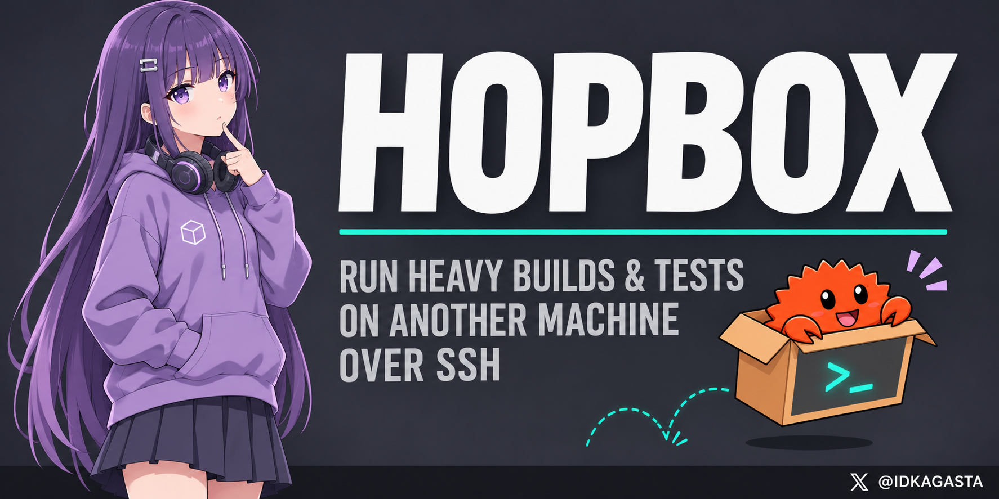

<h1 align="center">hopbox</h1>

<p align="center"><b>Run heavy builds and tests on another machine over SSH, from your laptop or your coding agent.</b></p>

<p align="center">
  <a href="https://crates.io/crates/hopbox"></a>
  <a href="https://github.com/Itz-Agasta/hopbox/actions/workflows/ci.yml"></a>
  <a href="https://github.com/Itz-Agasta/hopbox/releases/latest"></a>
  <a href="#license"></a>
  
</p>

<p align="center">
  <a href="docs/getting-started.md">Getting started</a> •
  <a href="docs/commands.md">Commands</a> •
  <a href="docs/providers.md">Rent a GPU</a> •
  <a href="docs/agents.md">For coding agents</a> •
  <a href="docs/exit-codes.md">Exit codes</a>
</p>

<p align="center">
  
</p>

You keep working on your laptop. When a job is too heavy for it, `hopbox` copies the repo to a remote machine, runs the command there, streams the output back, and exits with the command's exit code:

```sh
hopbox run -- cargo nextest run
```

```text
… test output, streamed live …
hopbox: exit=0 source=remote host=hermes dur=41.8s
```

hopbox is built for coding agents such as Claude Code as much as for people. A bundled skill tells an agent when to offload a job and how to read the result:

```sh
npx skills add Itz-Agasta/hopbox --skill hopbox -g     # Claude Code, Codex, Cursor, and more
```

In Claude Code you can also run `/plugin install hopbox --marketplace Itz-Agasta/hopbox`.

## Install

With Cargo, from [crates.io](https://crates.io/crates/hopbox):

```sh
cargo install hopbox          # build from source (Rust 1.85+)
cargo binstall hopbox         # or fetch the prebuilt binary with cargo-binstall
```

On Arch Linux, from the [AUR](https://aur.archlinux.org/packages/hopbox-bin):

```sh
paru -S hopbox-bin
```

Or with the installer script, which downloads the right prebuilt binary for Linux or macOS on x86_64 or ARM:

```sh
curl --proto '=https' --tlsv1.2 -LsSf https://github.com/Itz-Agasta/hopbox/releases/latest/download/hopbox-installer.sh | sh
```

You can also download an archive from the [releases page](https://github.com/Itz-Agasta/hopbox/releases), or build the latest `main` with `cargo install --git https://github.com/Itz-Agasta/hopbox`.

## Quick start

Add a host to `~/.config/hopbox/config.toml`:

```toml
default_host = "hermes-vps"

[hosts.hermes]
ssh = "hermes-vps"   # anything `ssh hermes-vps` reaches: keys, jump hosts, Tailscale
memory_max = "6G"    # each job gets its own memory cap
```

Check it, then run something:

```sh
hopbox doctor
hopbox run --tail 60 -- cargo nextest run
```

See [Getting started](docs/getting-started.md) for the full walkthrough.

## What it does

- **Runs your command remotely and passes its exit code through.** The last line of every run is a status line (or `--json` object) whose `source=remote|hopbox` tells a failed test apart from a failed connection.
- **Syncs only what matters.** `rsync` sends your working tree, uncommitted changes included, and skips `.git`, everything git ignores, and secret-looking files such as `.env` and keys. Each worktree gets its own remote copy, so parallel agents never collide.
- **Borrows the machine without taking it over.** Every job runs in its own systemd scope with a memory cap and CPU weight. A runaway build is killed (`exit=137 oom=true`) before it harms anything else on the box.
- **Keeps long jobs out of your way.** `hopbox run --bg` starts a job that survives a closed terminal or a sleeping laptop; `hopbox wait` returns its exit code later.
- **Forwards ports.** `hopbox run --port 3000 -- npm run dev` opens the remote dev server on your `localhost:3000`.
- **Rents a GPU when you need one.** `hopbox up vast --gpu RTX_4090 --ttl 2h` shows the price, asks first, and the instance destroys itself at its deadline using its own restricted key.

The remote needs `ssh`, `rsync`, `bash`, and `flock`. hopbox installs nothing on it and opens no ports.

## Commands

| Command | What it does |
|---|---|
| `hopbox run -- <cmd>` | Sync, run, stream, exit with the command's code. `--bg`, `--port`, `--tail`, `--fetch`, `--env`, `--task`, `--mem`. |
| `hopbox jobs` / `logs` / `wait` / `kill` | Manage background jobs. |
| `hopbox up` / `ls` / `down` | Rent, list, and destroy vast.ai GPU instances. |
| `hopbox doctor [host]` | Report what a host has and lacks. Never installs anything. |
| `hopbox gc [host]` | Remove old remote copies and finished jobs. |

Every flag is in [Commands](docs/commands.md).

## Documentation

- [Getting started](docs/getting-started.md)
- [Commands](docs/commands.md)
- [Rent a GPU box](docs/providers.md)
- [Configuration](docs/config.md)
- [Exit codes](docs/exit-codes.md)
- [Using hopbox from coding agents](docs/agents.md)

## License

Licensed under either of [Apache License, Version 2.0](LICENSE-APACHE) or [MIT license](LICENSE-MIT) at your option.
